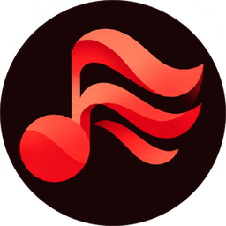

<h1 align="center">Segue</h1>

<h3 align="center">Connect for self-hosted music.</h3>

  Each of your devices sees what the others are playing, controls any of them, and moves the music
  from one to another without losing its place, across apps and servers, on OpenSubsonic
  (Navidrome and others) or Jellyfin.

---

Apps implement one protocol. A small hub runs next to the media server: it signs devices in with
the credentials they already use there, keeps the state of each player and routes commands between
them. Audio still streams from the media server.

| Repository | What |
|---|---|
| [**segue**](https://github.com/segue-music/segue) | The protocol ([`SPEC.md`](https://github.com/segue-music/segue/blob/main/SPEC.md)), a draft of an open Connect for OpenSubsonic and Jellyfin apps, and its reference hub, in Go |
| [**segue-app**](https://github.com/segue-music/segue-app) | A music player for Navidrome, other OpenSubsonic servers and Jellyfin, built on Segue Connect. Flutter: Linux, Windows, macOS, Android and iOS |

**Status: early.** The protocol is a first draft, offered to Navidrome as design input
([#5154](https://github.com/navidrome/navidrome/discussions/5154#discussioncomment-18927485)) and
put to OpenSubsonic's app and server developers
([#283](https://github.com/opensubsonic/open-subsonic-api/discussions/283)). The hub and the app
have run next to a real Navidrome since October 2026. The app's builds for Android, Linux and
Windows are in [its releases](https://github.com/segue-music/segue-app/releases).

> [!NOTE]
> **Vibe-coded.** The spec, the hub and the app are written by Claude (through Claude Code), with a
> person deciding what to build and trying it on real devices.

MIT licensed.
